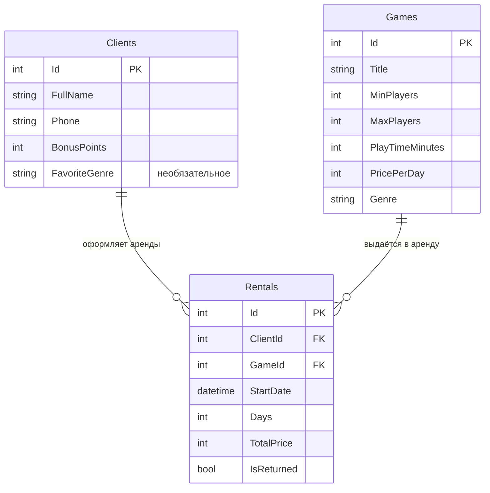

# MeepleRent — клуб-прокат настольных игр «Милпл»

Приложение для клуба, в котором берут напрокат настольные игры: клиенты, игры и аренды в одном месте.

## Автор

Гусаренко Владислав Павлович

## О проекте

«Милпл» — небольшой клуб-прокат настольных игр в Екатеринбурге. У клуба библиотека из двухсот игр: от быстрых «настолок» на полчаса до тяжёлых стратегий на вечер. Клиент приходит, выбирает игру по числу игроков, жанру и бюджету, забирает её домой на несколько дней и возвращает. За каждую аренду начисляются бонусные баллы, которые потом можно потратить на следующие аренды.

Приложением пользуются сотрудники клуба на стойке выдачи: они заводят клиентов, ведут каталог игр и оформляют аренды. Главное отличие клуба от обычного проката — библиотека игр с подбором по числу игроков и длительности партии, поэтому в каталоге важны не только название и цена, но и эти характеристики.

## Схема базы

## Таблицы

### Clients

В таблице хранятся клиенты клуба: как их зовут, как с ними связаться и сколько бонусных баллов они накопили.

| Поле | Тип | Обязательное | Описание |
|---|---|---|---|
| Id | int | да | Первичный ключ |
| FullName | string | да | Фамилия и имя клиента |
| Phone | string | да | Телефон для связи |
| BonusPoints | int | да | Накопленные бонусные баллы |
| FavoriteGenre | string | нет | Любимый жанр игр, помогает подбирать новинки |

### Games

В таблице хранится каталог игр клуба: название, число игроков, длительность партии, жанр и цена аренды за сутки.

| Поле | Тип | Обязательное | Описание |
|---|---|---|---|
| Id | int | да | Первичный ключ |
| Title | string | да | Название игры |
| MinPlayers | int | да | Минимальное число игроков |
| MaxPlayers | int | да | Максимальное число игроков |
| PlayTimeMinutes | int | да | Средняя длительность партии в минутах |
| PricePerDay | int | да | Цена аренды за сутки в рублях |
| Genre | string | да | Жанр игры: стратегия, кооперативная, вечериночная |

### Rentals

В таблице хранятся аренды: кто какую игру взял, на какой срок и за какую сумму.

| Поле | Тип | Обязательное | Описание |
|---|---|---|---|
| Id | int | да | Первичный ключ |
| ClientId | int | да | Внешний ключ на Clients |
| GameId | int | да | Внешний ключ на Games |
| StartDate | DateTime | да | Дата выдачи игры |
| Days | int | да | Срок аренды в днях |
| TotalPrice | int | да | Итоговая сумма аренды в рублях |
| IsReturned | bool | да | Игра уже возвращена в клуб |

## Связи

Таблица `Rentals` связывает `Clients` и `Games` через внешние ключи `ClientId` и `GameId`, оба обязательные. Один клиент за сезон берёт много игр, а одну игру берут многие клиенты, поэтому связь между главными таблицами — «многие ко многим», а `Rentals` выступает связующей таблицей и хранит ещё и данные самой аренды: дату выдачи, срок, сумму и признак возврата.

Внешние ключи ссылаются на записи, а не повторяют их данные: в `Rentals` лежит `ClientId`, а не имя клиента, поэтому при исправлении телефона или названия игры меняется только одна строка в главной таблице.
